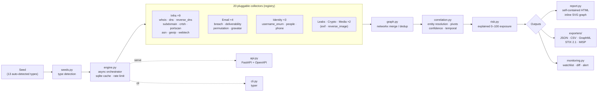

# reconweave

**An offline-first OSINT correlation platform.** reconweave fuses 20 collectors
into one entity graph, pivots across identities (email → username → platforms →
org), scores exposure on an explained 0–100 scale, and renders a self-contained
HTML report — with exports to JSON, CSV, GraphML/Maltego, STIX 2.1, and MISP.

It runs **FULLY OFFLINE by default**: every collector produces *deterministic
synthetic data* keyed off `sha256(seed)`. Zero API keys, zero network. Real
collectors are gated behind `--live`. That makes it safe to demo, test, and
reason about — the same seed always yields the same graph.

> Author: **Dhanush Shankar** &lt;danushankar3@gmail.com&gt; · MIT licensed.

---

## Architecture



**Data model.** 12 node types (`domain, subdomain, ip, cidr, email, username,
person, org, phone, asn, crypto_wallet, social_profile`) connected by 8 typed
edges (`owns, resolves_to, subdomain_of, member_of, appears_in_breach,
same_identity, controls, linked_to`). Every collector returns entities +
relationships + a `source` + a `confidence`, so independent discoveries of the
same thing merge into one node with unioned provenance and max confidence.

---

## Quickstart

```bash
pip install -e .            # or: pip install -r requirements.txt
reconweave scan example.com
```

```bash
reconweave scan someuser --type username     # force a seed type
reconweave scan john@example.com --report out.html --json out.json
reconweave export jane@example.com --format stix --out bundle.json
reconweave collectors                        # list all 20 collectors
reconweave watch add example.com             # baseline for monitoring
reconweave watch check example.com           # diff + alerts on re-scan
reconweave serve                             # FastAPI on :8000 (docs at /docs)
```

Run against real sources (network) by adding `--live` — off by default.

---

## Collector catalog (20)

| Collector | Category | Accepts | Mode | What it produces |
|-----------|----------|---------|------|------------------|
| `whois` | infra | domain, subdomain | offline | Registrant, registrar, and registration dates for a domain. |
| `dns` | infra | domain, subdomain | offline | A/AAAA/MX/NS records resolving a domain to IPs and mail hosts. |
| `reverse_dns` | infra | ip | offline | PTR lookup mapping an IP back to a hostname. |
| `subdomain` | infra | domain | offline | Enumerates subdomains via wordlist/passive DNS. |
| `crtsh` | infra | domain | offline | Certificate Transparency (crt.sh style) subdomain discovery. |
| `portscan` | infra | ip | offline | Open TCP ports and banners for an IP. |
| `asn` | infra | ip, asn | offline | ASN / BGP origin and announced prefix for an IP or ASN. |
| `geoip` | infra | ip | offline | Geolocation (country, city, coordinates) for an IP. |
| `webtech` | infra | domain, subdomain | offline | Web technology fingerprint (server, CMS, JS, CDN). |
| `breach` | email | email | offline | Breach exposure (Have-I-Been-Pwned style) for an email. |
| `deliverability` | email | email | offline | MX / SMTP / disposable / role-account signals. |
| `permutation` | email | email, person, username | offline | Likely email/username permutations from a seed. |
| `gravatar` | email | email | offline | Gravatar profile + avatar hash for an email. |
| `username_enum` | username | username, social_handle | offline | Checks 40+ platforms (Sherlock-style) and links profiles. |
| `people` | people | person | offline | Person enrichment: employer, title, location, emails, aliases. |
| `phone` | phone | phone | offline | Phone intel: carrier, country, line type, linked accounts. |
| `leaks` | leaks | email, username, domain, crypto_wallet, phone | offline | Paste-site / combolist mentions (dark-web stand-in). |
| `crypto` | crypto | crypto_wallet | offline | Wallet balance, tx count, counterparty wallets (controls/links). |
| `exif` | media | file_hash | offline | EXIF (GPS, camera, timestamp) from an image via Pillow. |
| `reverse_image` | media | file_hash | offline | Perceptual (average) hash for reverse-image matching via Pillow. |

The `media` collectors compute **real** perceptual hashes / EXIF via Pillow when
given an actual image file (`ctx["file"]`), and fall back to deterministic
synthetic metadata otherwise. Everything else is deterministic synthetic data.

---

## Correlation & risk

- **Pivots**: `email → username` (local-part resolution), `username → platforms`
  (identity fusion across 40+ sites), `identity → org` (affiliation via shared
  people). Confidence is combined with a noisy-OR (`1 − Π(1 − pᵢ)`).
- **Temporal**: nodes carry `first_seen`; correlation stamps a temporal rank.
- **Risk** (`risk.py`): a weighted, capped, **explained** 0–100 score. Factors
  include credential breaches, leak/paste mentions, exposed network services,
  subdomain sprawl, social footprint, email exposure, geo pinpoint, and crypto
  exposure. Every factor ships with points + a human-readable detail, so the
  score is auditable — you can see exactly *why* an entity is exposed.

---

## Export formats

| Format | Command | Notes |
|--------|---------|-------|
| JSON | `--format json` | Full scan result (nodes, edges, risk, correlations). |
| CSV | `--format csv` | `# nodes` + `# edges` sections in one file. |
| GraphML | `--format graphml` | Opens in Gephi / yEd. |
| Maltego | `--format maltego` | GraphML alias — import as a Maltego graph. |
| STIX 2.1 | `--format stix` | Hand-built valid bundle (SCOs/SDOs + `relationship` SROs), **no `stix2` dependency**. Deterministic uuid5 ids. |
| MISP | `--format misp` | Hand-built MISP Event JSON (Attributes + Tags), **no dependency**. |

```bash
reconweave export example.com --format graphml --out graph.graphml
reconweave export jane@example.com --format misp --out event.json
```

See committed sample runs in [`examples/`](examples/): `domain`, `email`, and
`username` scans as JSON, STIX, and an HTML report each.

---

## API usage

```bash
reconweave serve            # http://127.0.0.1:8000  (OpenAPI docs at /docs)
```

```bash
curl -s localhost:8000/health
curl -s localhost:8000/collectors | jq '.count'
curl -s -X POST localhost:8000/scan -H 'content-type: application/json' \
     -d '{"seed":"example.com"}' | jq '.risk.score'
curl -s -X POST localhost:8000/export/stix -H 'content-type: application/json' \
     -d '{"seed":"jane@example.com"}'
```

Endpoints: `GET /health`, `GET /collectors`, `GET /seed-type/{value}`,
`POST /scan`, `POST /export/{fmt}`. Full schema at `/openapi.json`.

---

## Plugging in real sources

Every collector is a small class in a registry (`collectors/base.py`). A real
source is a drop-in replacement that keeps the same return contract
(`entities + relationships + source + confidence`) and sets `live = True`:

```python
from reconweave.collectors.base import Collector, CollectorResult, register
from reconweave.seeds import SeedType

@register
class MyBreachIntel(Collector):
    name = "breachintel"
    category = "email"
    accepts = (SeedType.EMAIL,)
    live = True          # only runs with --live

    def run(self, value, seed_type, ctx):
        # call your real service here, map results to Entity/Relationship
        return CollectorResult(entities=[...], relationships=[...],
                               source=self.name, confidence=0.9)
```

This is exactly where my own intel projects slot in — **breachintel**,
**leakradar**, and **darkweb-intel** — replacing the offline `breach` / `leaks`
mock collectors with live feeds while every downstream stage (graph merge,
correlation, risk, exporters, report) stays unchanged.

---

## Development

```bash
pip install -e ".[dev]"
pytest                     # 90+ tests: seed detect, collector contracts,
                           # graph merge/dedup, pivots + confidence + risk math,
                           # every exporter (incl. STIX/GraphML), monitoring
                           # diff, CLI + API smoke.
```

Layout: `src/reconweave/` — `seeds`, `entities`, `collectors/`, `graph`,
`correlation`, `risk`, `engine`, `exporters/`, `monitoring`, `report`, `config`,
`cli`, `api`.

---

## Ethics & legal

reconweave is built for **passive, authorized OSINT** and defensive security
research. By design:

- **Offline by default.** No network calls, no API keys, no data leaves your
  machine unless you explicitly pass `--live`. All default output is synthetic.
- **No real personal data** ships in this repository. Every example is
  deterministically generated from a seed string — the "breaches", "wallets",
  "profiles", and "people" are fabricated.
- **`--live` is your responsibility.** Only run live collectors against assets
  and identities you are authorized to investigate, and comply with each
  source's terms of service and your local law (e.g. CFAA, GDPR, the UK CMA).
- reconweave performs **reconnaissance only** — it never exploits, brute-forces,
  or accesses accounts. Use it to understand and reduce your own exposure.

Use responsibly.
